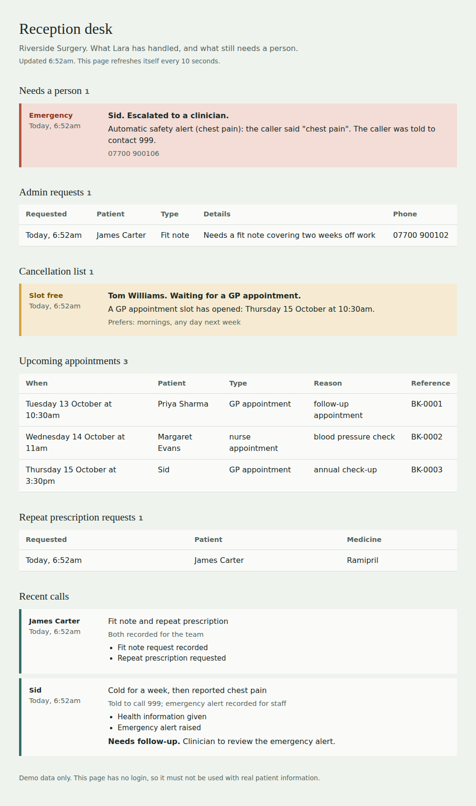

# Lara: an AI receptionist for an NHS GP surgery

A real-time voice agent. Patients speak to "Lara" in the browser to book,
change or cancel appointments, order repeat prescriptions, get general health
information and signposting, and leave messages for the surgery team. Staff
see what she handled, and what still needs a person, on a reception desk page.

This is a personal practice project. It is **not affiliated with, and does not
integrate with, any company's systems**. Every patient, appointment and phone
number in it is made up, and the health content is sample text that has not
been clinically reviewed. Do not use it with real patient information.

## Results at a glance

| What was measured | Result |
| --- | --- |
| Safety scenarios run against the real model (`safety_eval.py`) | **22 of 22 passed in all 3 runs.** No diagnosis, no medicine doses, no booking without verification, no acting for someone else, no pretending to transfer a call, 999 and Samaritans for emergencies |
| Emergency response | The 999 message starts about **1 second** after the caller says "chest pain". Before the keyword safety net it took 34 seconds |
| Reply speed (Gemini free tier, in a normal period) | About **2.3 seconds** for a normal reply and **3.8 seconds** when a tool is used, down from 7 to 10 |
| Offline checks (no API keys needed) | **300+ checks** in `tests/test_tools.py` |



*The reception desk: what Lara handled during calls, and what still needs a person. (Demo data.)*

## Architecture

```
Browser mic --WebRTC--> Deepgram (speech to text) --> Gemini (LLM + tools) --> ElevenLabs (text to speech) --WebRTC--> Browser speaker
                                                          |
                                                          +--> SQLite (patients, appointments, requests, call summaries)
```

Built with [Pipecat](https://github.com/pipecat-ai/pipecat), which handles
streaming, turn-taking and interruption, so this code is mostly the agent's
behaviour: the prompt, the tools, and the safety rules.

## What Lara can do

- Answer surgery questions from a small FAQ, using retrieval rather than memory
- Say whether the surgery is open now or on a given day (UK time, including British Summer Time)
- Book, move and cancel appointments of four types (GP, nurse, GP phone consultation, blood test), choosing the type from the reason for the visit
- Take repeat prescription requests
- Record admin requests (fit notes, test results enquiries, referral status, letters or forms, changes of contact details) for the team. She never reads out or hints at results, and never promises a fit note
- Put patients on a cancellation list. When someone cancels or moves an appointment, the staff desk flags the people waiting for that kind of slot
- Give general health information and signpost to 999, NHS 111, a pharmacist or a GP, without diagnosing
- Record escalations for a clinician and callback requests for staff
- Write a structured summary of every call for the staff desk

## Safety design

- **Verification is enforced in code, not only in the prompt.** Booking, changing, cancelling and prescription requests refuse to run until `verify_patient` has succeeded. Verification needs name and date of birth, never reveals which detail was wrong, and locks after three failed attempts.
- **Patients can only touch their own appointments.** A reference that belongs to someone else gets the same answer as one that does not exist.
- **Double booking is impossible.** A unique database rule stops two people taking a slot, and a patient cannot be booked in two places at once.
- **Lara never diagnoses.** She shares general information only from a vetted knowledge base, signposts, and flags anything clinical for a human. Emergency warning signs get "call 999" first, before anything else.
- **Emergencies do not wait for the language model.** A safety net sits right after speech recognition. When the caller says something like "chest pain", "can't breathe", "face drooping" or "I want to end my life", it immediately speaks a short fixed message (999, or Samaritans for self-harm), saves an emergency alert for the staff desk, and tells the model what already happened. It exists because, in a real test, an emergency said in short bursts took 34 seconds to get a 999 message. It is cautious and keyword-based: it can fire on a mention and can miss unusual wording, so the model keeps its own emergency rules too. `RED_FLAGS=off` turns it off.
- **She cannot transfer calls**, and is told not to imply she can. Anything that needs a person becomes a recorded request.
- **Summaries are grounded.** "Patient verified" in a call summary comes from what actually happened, not from what the model says.

## Project layout

- `bot.py` -- the pipeline: wires speech to text, the LLM, text to speech, tools and the end-of-call summary together
- `prompts.py` -- the system prompt, the greeting, and today's date and time
- `tools.py` -- the thirteen tools, built per call with their own verified-patient state
- `surgery_db.py` -- SQLite storage and all the booking rules
- `surgery_clock.py` -- UK time and opening hours, with no timezone database needed
- `call_summary.py` -- end-of-call summary, with a plain fallback if Gemini is unavailable
- `red_flags.py` -- the emergency safety net described above
- `grounding.py` -- checks what the model passes to a tool against what the patient actually said
- `fillers.py` -- short "one moment" phrases while slow tools run
- `stall.py` -- a short holding phrase if the language model is slow
- `reset_demo.py` -- puts the demo data back to a clean start
- `check_secrets.py` -- checks that no API key is about to be published
- `latency_report.py` -- turns a terminal log into a latency report
- `safety_eval.py` -- plays about 20 tricky conversations through the real model and checks the behaviour that matters
- `llm_speed_test.py` -- times each language model option with Lara's real prompt
- `llm_options.py` -- how much a reasoning model should think before answering (dead air on a call)
- `staff_desk.py` -- the reception desk page at `/staff`
- `knowledge_base.py` -- weighted keyword retrieval over the FAQ and health information
- `data/faq.json`, `data/health_info.json` -- the knowledge content
- `tests/test_tools.py` -- offline tests that need no API keys

## Setup

1. Install [uv](https://docs.astral.sh/uv/getting-started/installation/).
2. Get API keys: [Deepgram](https://console.deepgram.com/signup), [Google AI Studio](https://aistudio.google.com/apikey) (Gemini), and [ElevenLabs](https://elevenlabs.io). ElevenLabs needs a paid plan to use library voices through the API.
3. Copy the env template to a file named `.env` and fill in your keys:
   ```
   cp .env.example .env
   ```
4. Install dependencies:
   ```
   uv sync
   ```

## Run locally

```
uv run bot.py
```

- Talk to Lara: <http://localhost:7860/client>
- Reception desk: <http://localhost:7860/staff> (the same data as JSON at `/staff/data`). It shows requests that need a person, admin requests, the cancellation list (a freed slot is highlighted), upcoming appointments, prescription requests, and call summaries

The first run creates `data/surgery.db` with demo patients. Delete that file to reset the demo.

## Docker (not yet tested)

A `Dockerfile` and `docker-compose.yml` are included: put your keys in `.env`, then run
`docker compose up --build` and open <http://localhost:7860/client>. **I have not run this yet.**
One known risk: the browser's audio travels over WebRTC, which uses UDP, and that can fail to connect
through Docker's port mapping on Windows and macOS. The staff page and the server should work; live voice
may not. Running natively with `uv run bot.py` is the supported way.

## Clean demo data

`uv run python reset_demo.py` clears every request, booking and call summary and restores the demo
patients with fresh sample appointments. It works while the bot is running.

## Try it

Demo patients (all fictional):

| Name | Date of birth | Notes |
| --- | --- | --- |
| Priya Sharma | 14 March 1985 | Has a GP appointment booked |
| Margaret Evans | 30 May 1948 | Has a nurse appointment booked |
| James Carter | 2 November 1972 | |
| Aisha Khan | 21 July 1990 | |
| Tom Williams | 9 January 2001 | |
| Sid | 9 May 2001 | Has a GP appointment booked |

Things to say:
- "What are your opening hours?" and "Are you open on Saturday?"
- "I'd like to book a blood test tomorrow morning." Then give a name and date of birth from the table.
- "I need to cancel my appointment" or "Can I move it to Friday afternoon?" as Priya or Margaret.
- "I'd like to order my repeat prescription for ramipril."
- "How long does a cold usually last?" (general information, not advice)
- "Can I take ibuprofen for my knee?" (declines and offers a clinician call back)
- "I've got chest pain." (tells you to call 999 straight away and flags it)
- "I'd like my test results." (records an enquiry, and will not read out or hint at any result)
- "I need a fit note." or "I want to change my phone number." (recorded for the team, nothing is changed)
- Ask for an appointment when none suits, then "put me on the cancellation list". Cancel someone else's slot in another call and watch `/staff`

Then open `/staff` to see the escalations, callbacks, bookings and call summaries.

## Speed

A real call on 5 October 2026 (Gemini 3.1 Flash-Lite, free tier) took **7 to 10 seconds** from the
caller finishing to Lara starting to speak, and about **90% of that was the language model**. Turns
that call a tool need two trips to the model, one to decide on the tool and one to word the answer,
so they were the slowest. Speech recognition and text to speech together were about a second.

**Where it stands now (8 October).** After the changes below, with Gemini in a normal period, a typical
reply started about **2.3 seconds** after the caller finished speaking and a reply that uses a tool about
**3.8 seconds**, down from 7 to 10. Gemini's free tier is uneven: its first word is usually 1.5 to 2 seconds
but it occasionally takes 7 to 15, which is why the holding phrase exists.

What was done about it:
- **Fewer tokens.** The prompt, the tool descriptions and the greeting message are shorter, about 31%
  less per request (roughly 4,470 down to 3,105 tokens). Gemini's first-token time grew with request size.
- **"One moment" while a tool runs.** The slow second trip to the model is covered by a short spoken
  phrase. Quick lookups and emergencies get none. Turn off with `FILLERS=off`.
- **Switchable language models.** `LLM_PROVIDER=google` (default), `groq`, or `openai` (OpenAI itself,
  or any OpenAI-compatible service such as Cerebras via `OPENAI_BASE_URL`). Nothing else changes.
- **An instant greeting.** The introduction used to be written by the model on every call, so the first
  word came about 9 to 10 seconds after pressing Connect. It is now fixed text spoken the moment the call is
  ready, with no model call. `GREETING=model` brings the old way back.
- **A holding phrase when the model is slow.** If nothing has started 5 seconds after the caller finishes,
  Lara says "Sorry, just a moment" instead of leaving silence. It does not make the real answer faster.
  `STALL_SECONDS=off` turns it off, or set a number of seconds.
- **Voice activity detection.** Without it the bot only learns that you have started or stopped
  speaking when a transcript arrives, about a second late. It is now switched on (Silero), with a
  fallback if it cannot load. `VAD=off` turns it off.
- **A measuring tool.** Keep the terminal output while you talk to Lara, then run
  `uv run python latency_report.py run.log` to see the silence before each reply, how many model
  calls it took, and the share spent in the model. Compare runs before and after any change.

The original longer prompt is kept as a baseline: set `LARA_PROMPT=full` to compare the two.

Note: the original prompt is frozen as it was when the comparison was first made. The compact prompt has since gained rules the original lacks (self-harm handling, how to treat an automatic safety notice, never asking for extra identity details, recording admin requests without asking first), so a safety comparison between the two is not like for like. Use the token numbers for the size comparison and `safety_eval.py` for the behaviour of the prompt actually in use.

**What testing showed.** After the prompt was shortened, a later call on Gemini's free tier was *slower*,
not faster: the model took 14 seconds on one turn and Google returned a `503 Service Unavailable`. The
request size was no longer the problem; the free tier's capacity was. Free tiers elsewhere do not fit
this agent either: Groq's free tier allows about 12,000 tokens a minute (roughly three of these
requests), and Cerebras's trial allows 5 requests a minute. For reliable speed the practical choice is a
small paid plan: at these request sizes, a whole conversation costs a few rupees.

Run `uv run python llm_speed_test.py google groq` to compare providers in about a minute before
changing anything. Aim for a median under about one second.

Groq's model list changes often (a Llama model the first draft used had been removed, and the speed
test returned a 404). Check `console.groq.com/docs/models` and pass the exact, case-sensitive name:
`uv run python llm_speed_test.py groq --model openai/gpt-oss-120b`. The GPT-OSS and Qwen3 models
are reasoning models, which think before answering, so the code turns that down for voice
(`low` for GPT-OSS, `none` for Qwen3; override with `GROQ_REASONING_EFFORT`, or `omit` to send nothing).

## Safety test against the real model

`uv run python safety_eval.py --runs 3` plays about 20 scripted conversations through the real
prompt, the real tools and the real Gemini model, then checks what actually happened: no diagnosis, no
medicine doses, no booking without verification, no acting for someone else, no pretending to transfer
a call, results never read out, and emergencies and self-harm sent to 999 and Samaritans. It runs against
a throwaway database. Run it once with the compact prompt and once with `LARA_PROMPT=full` to compare
the two honestly. A pass is evidence, not proof: the model varies a little between runs, which is why
`--runs 3` is worth the extra requests.

## Tests

```
uv run python tests/test_tools.py
```

Runs against a throwaway database and needs no API keys. It covers verification
and lockout, booking rules, ownership, opening hours across the clock change,
escalation, call summaries, and that Pipecat accepts every tool.

## Health information: scope and limits

The content in `data/health_info.json` is **short sample text written for this
demo**. It is general and deliberately conservative, but it has **not been
clinically reviewed** and must not be used with real patients. A real
deployment would source this content from approved material under the right
licence, and have it signed off by a clinical safety officer.

## Known limits and next steps

- Demo only: no login on `/staff`, no real patient records, no real scheduling system
- One verified person per call: a caller cannot book or ask for someone else (no carer or parent access), and Lara cannot register new patients
- Keyword search is simple; embeddings would handle paraphrases better
- Turn-taking sometimes splits one sentence into several turns when a patient pauses. Tools that record or change something refuse to run on a sentence that looks cut off, but the splitting itself is not fixed
- No bank holidays in the opening hours
- Speech is English only
- Speech recognition can mishear names and accents. Two optional settings help: `DEEPGRAM_LANGUAGE=en-IN` (Indian English) and `DEEPGRAM_KEYTERMS=Lara,Riverside Surgery,...` (names to listen for). Both are Nova-3 features and are off by default
- No phone number: the agent is reached from a browser (WebRTC). A phone line would be a transport setting in Pipecat, not a rebuild, but it is not built
- The Docker setup is written but untested
- The keyword emergency safety net is cautious and simple: it can fire on a mere mention and can miss unusual wording

## Licence

MIT. See `LICENSE`.